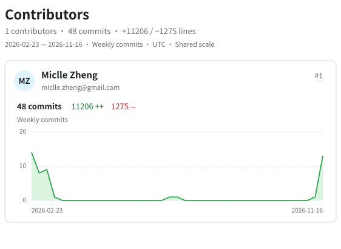

# 参与贡献

欢迎通过 Issue 反馈问题、提出建议，或提交 Pull Request 改进 gh-report。

## 贡献统计



[查看完整报告与数据表格](https://github.com/miclle/gh-report/tree/gh-report/reports/commit-report)

图表随报告发布自动更新，展示提交数量、增删行数及逐周活动趋势。统计口径见[提交统计文档](docs/commits.md)。

## 本地开发

安装 `go.mod` 声明的 Go 版本后，在仓库根目录运行：

```bash
make build
go test ./...
go test -race ./...
go vet ./...
```

配置方式和命令示例见 [README](README.md)。本地配置可保存为已被 Git 忽略的 `config.local.yaml`。

## 提交 Pull Request

- 每个 PR 聚焦一个目标，说明解决的问题、最终行为和验证结果。
- 行为变更补充相关测试，并同步更新对应的使用文档。
- 注释和文档使用中文；导出的 Go 函数和类型添加以标识符开头的文档注释。
- 提交信息使用简化 Angular 格式，例如 `feat(actions): 支持固定图表引用`。
